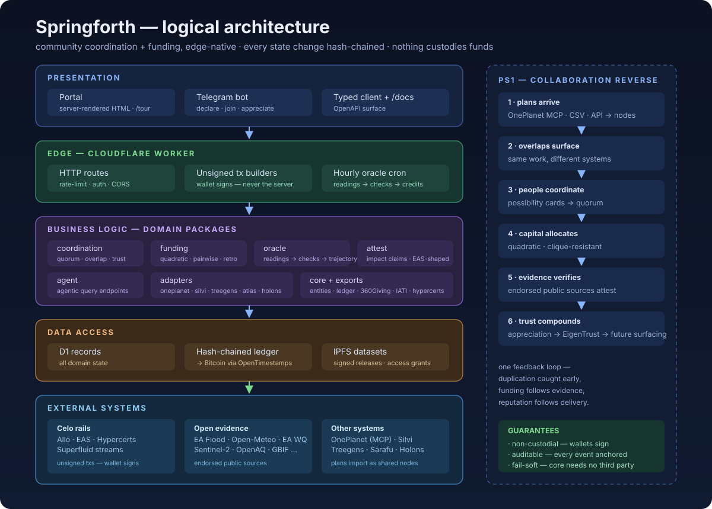

# Logical Architecture

High-level view of the system for the PS1 brief — what each tier does, which
components live where, and where external systems connect. Source of truth is
the monorepo itself; this maps it.

## Presentation layer

| Surface | Component | Notes |
|---|---|---|
| Web portal | `src/portal` | Server-rendered HTML; no JS build step; every route reachable by a judge |
| Chat | `src` (edge worker) Telegram webhook | Declare, join, appreciate, quorum announcements back to the group |
| API client | `src/client.ts` + `/docs` | Typed SDK generated from the OpenAPI surface; `/tour` is the guided judge path |

## Business-logic layer (domain packages)

| Package | Responsibility |
|---|---|
| `coordination` | Possibility lifecycle (declare → opt-in → quorum → expire), plan-graph needs/offers, overlap detection + human validation, appreciation → pairwise trust (EigenTrust), dominant-assurance pledges, interest/pass feed signals, gazetteer + h3 geo resolution |
| `funding` | Quadratic allocation (Liberal Radicalism), pairwise mode with clique discount via the trust graph, conviction weighting, evidence→allocation multiplier, retro rounds, stream intents |
| `oracle` | Source registry, hourly readings per action node, baseline-aware checks, trajectory scoring, measure-to-earn credits; live/keyless + key-gated source lanes kept distinct |
| `attest` | Impact claims, attestation requests, EAS-shaped outcomes |
| `agent` | Agent-facing endpoints for the plan graph and overlap proposals |
| `core` | Entity schemas (zod) + the hash-chained audit ledger; entities include `CouncilSeat` (auto-seated at quorum) and `ForumPost` (council-gated), `Interest`/`Pass` feed signals |

Maps to the organizer's "marketplace for community liquidity" slide:
**Surface** = declare · **Match** = commit/quorum · **Fund** = pledges+rounds ·
**Deliver** = reports · **Measure** = oracle + valuation · **Steward** =
councils + endowment.

## Data-access layer

| Store | Contents |
|---|---|
| Cloudflare D1 | All domain records (possibilities, nodes, edges, rounds, donations, checks, proposals, datasets) |
| Ledger | Every state change hash-chained; heads anchored to Bitcoin via OpenTimestamps public calendars |
| IPFS | Signed dataset releases; `DataAccessGrant` records control disclosure |

## External systems

- **Chain rails (Celo)** — Allo quadratic funding, EAS attestations,
  hypercert-shaped claims, Superfluid streams. The worker only builds
  **unsigned transactions**; the participant's wallet signs and broadcasts.
  Nothing custodies funds.
- **Integration adapters** — OnePlanet (MCP, Streamable HTTP per the official
  quickstart), Silvi, Treegens, Atlas, Holons, Open Collective, CLC,
  ValueFlows, Artizen. Each normalises foreign plan structures into plan
  nodes with provenance.
- **Open-evidence sources** — live readings from public APIs; see
  `docs/hackathon/DATA-SOURCES.md` for the full matrix (hackathon-endorsed
  UK sources included).
- **Knowledge graph / agentic lane** — OnePlanet MCP + our `agent` package:
  plans in other systems arrive as nodes, overlap detection surfaces
  conflicts, validation resolves them — the PS1 loop end-to-end.

## Why this shape

- **Thin edge, fat packages** — every rule is testable TypeScript in
  `src/`; the worker is an HTTP shell. Portable off Cloudflare.
- **Fail-soft data access** — every external read degrades to `null`;
  the coordination core never depends on a third-party SLA.
- **Provenance everywhere** — imports, readings, and attested outcomes all
  land on the same ledger, so "where did this claim come from" is always
  answerable on-screen.
- **Non-custodial by construction** — value moves only through transactions
  the user signs; there is no custody boundary to breach.
